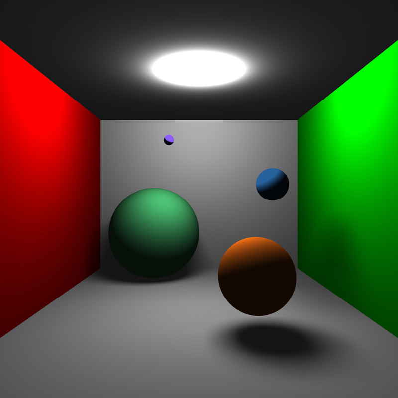
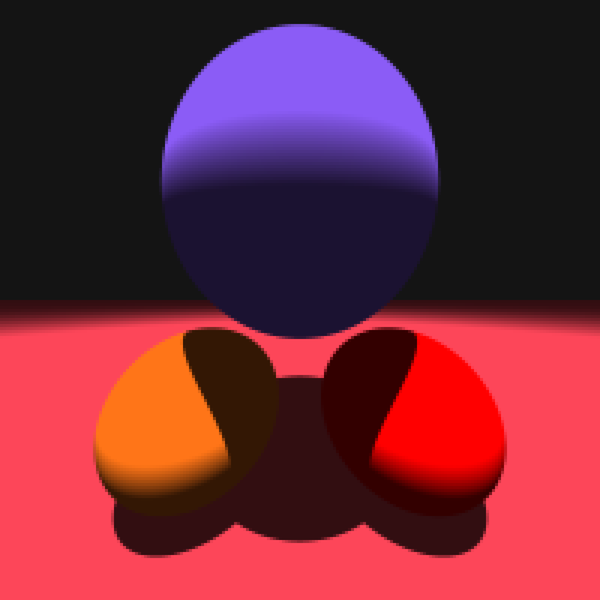
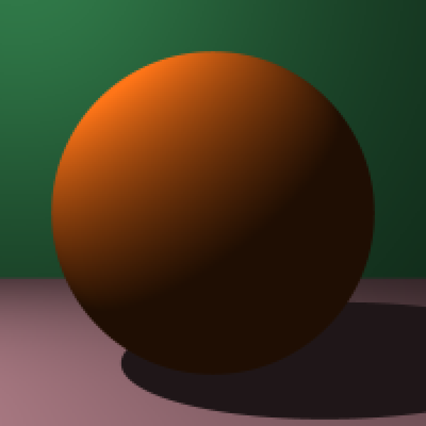
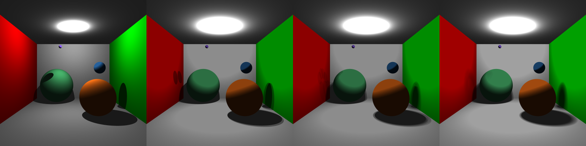
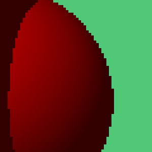
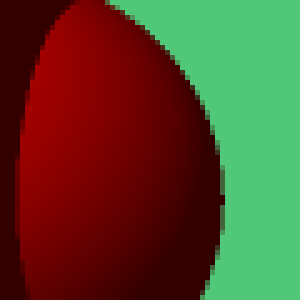

# Lattice-Based Sampling in Computer Graphics

A ray tracer I'm writing from scratch in C++20 for a directed study at the University of Alberta, Augustana, supervised by [Dr. Thibaud Lutellier](https://apps.ualberta.ca/directory/person/lutellie). The plan is to turn it into a path tracer and measure how rank-1 lattice sampling compares to random and Sobol sampling.

<p align="center">
  
</p>
<p align="center"><sub>A Cornell box lit by a square light on the ceiling, with 8×8 anti-aliasing and 225 shadow rays per hit point.</sub></p>

<p align="center">
  
  
</p>
<p align="center"><sub>Soft shadows from sphere-shaped lights, 16 shadow rays per hit point.</sub></p>

## What works

- A camera with a position and a vertical field of view
- Spheres, planes and rings
- Point lights with distance falloff, plus ambient light
- Soft shadows from sphere-shaped and square lights, using a grid of shadow rays spread over the light
- A Cornell box scene
- Grid anti-aliasing, from 1×1 up to 16×16 rays per pixel
- PPM output, and a helper that tiles several renders into one image

## What I'm working on

- Random sampling, the first step toward a path tracer
- Learning Vulkan through NVIDIA's [vk_mini_path_tracer](https://nvpro-samples.github.io/vk_mini_path_tracer/) tutorial, before porting this renderer to the GPU

## What's next

- [ ] Random bounces, to make it a real path tracer
- [ ] Rank-1 lattice and Sobol samplers, so the same scene can be rendered with each
- [ ] Measure each sampler's error against a high-sample reference render
- [ ] Port it to the GPU with Vulkan

## Sampling

Soft shadows and anti-aliasing both come from firing several rays and averaging them. Where those rays go is what this project is about.

Shadow rays per hit point: 1, 4, 16 and 225 (the first one has no anti-aliasing).

<p align="center">
  
</p>

Anti-aliasing at 1, 4, 16, 64 and 256 rays per pixel:

| 1×1 | 2×2 | 4×4 | 8×8 | 16×16 |
| :-: | :-: | :-: | :-: | :-: |
|  |  |  |  |  |

## Why lattices

Before this I spent summer 2026 on an NSERC USRA studying decryption failure in lattice-based post-quantum encryption (Learning With Errors, the problem behind NIST's ML-KEM). Rank-1 lattices use the same kind of structure for the opposite job. In cryptography the lattice hides a secret; in rendering it spreads sample points evenly so the image settles faster. How good a rank-1 lattice is for sampling comes down to the shortest vector in its dual lattice, which is the same kind of problem lattice cryptography depends on being hard.

## Build and run

Needs `g++` with C++20 support and `make`.

```sh
make
cd build && ./render.exe
```

`render.exe` renders the scenes set up in `src/render.cpp` and writes them as PPM files in the folder you run it from.

## How the code is laid out

| File | What it does |
| --- | --- |
| `src/vector.*` | The vector, point and color math everything else uses |
| `src/ray.*` | Rays, `P + tD` |
| `src/camera.*` | Turns a pixel into a ray, with position and field of view |
| `src/sphere.*`, `src/plane.*`, `src/ring.*` | The objects, each with its own intersection test |
| `src/ppm.*` | Writing images, and tiling several renders into one |
| `src/render.cpp` | Shading, shadows, anti-aliasing and the scenes |
| `src/create_ppm.cpp` | The first program I wrote for this, which just writes a PPM file |

## Notes

- [REPORT.md](REPORT.md): the running report for the course, with every step from writing the first PPM file to soft shadows and starting Vulkan.
- [Handwritten math notes](notes/math-notes.pdf): ray-sphere intersection, surface normals, lighting, shadows and anti-aliasing, worked through by hand.
- [Ray Tracing in One Weekend](https://raytracing.github.io/books/RayTracingInOneWeekend.html) was my starting guide.
